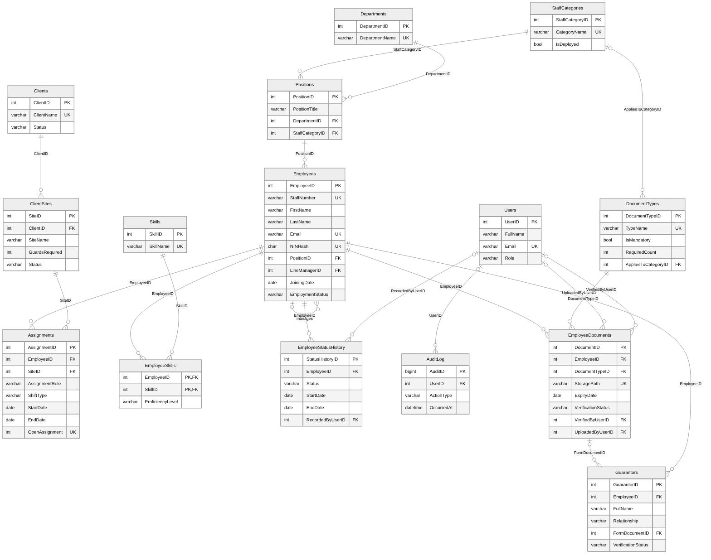

# Employee Management System: Database Design in SQL

A relational database for managing employees, their documents and their postings to client sites, written in MySQL 8. Everything is in one script, [employee_management_system.sql](employee_management_system.sql): database creation, tables, indexes, sample data, views and queries.

---

## Scenario

A staffing company employs two kinds of people:

- **Direct staff**, who run the company itself (HR, finance, IT).
- **Deployed staff** (guards, drivers, close protection officers), who are recruited for client companies and posted to the clients' sites.

The company needs one place to keep every employee's record, their signed documents and guarantors, where each person is posted right now and where they were posted before, and a history of every status change.

## Contents of the script

1. Database creation
2. Tables
3. Indexes
4. Sample data (all names, companies and numbers are fictional)
5. Views
6. Queries (joins, aggregation, CTEs and window functions)

## Normalisation

| Form | How the design meets it |
|---|---|
| **1NF** | Every column holds a single value. Repeating groups (skills, documents, guarantors, postings) sit in their own tables. |
| **2NF** | Every non-key column depends on the whole key. The EmployeeSkills table has a composite key and holds only data about that pairing. |
| **3NF** | No transitive dependencies. Department is reached through Position, and derived values (full name, years of service, current posting, document counts) are calculated in views, never stored. |

## The business problem

Before this database, everything was tracked in spreadsheets and shared folders. As the company grew, everyday questions became hard to answer:

- **Who is posted where right now?** When a client calls about a guard, finding that person meant searching several out-of-date spreadsheets.
- **Is every site fully staffed?** Each client has agreed how many guards they need at each site, but nobody could see the shortfall at a glance.
- **Is every deployed employee properly vetted?** Everyone must provide a signed offer letter, an ID and two signed guarantor forms. Finding the gaps meant opening every folder.
- **What happened to someone who left?** Leavers' rows were deleted or overwritten, so their history was lost.
- **Who has looked at sensitive documents?** There was no record of who opened what.
- **Can the data be trusted?** Spreadsheets accept anything: a guard at two sites at once, a leaver with no leaving date, a vehicle recorded against a guard.

## How the database solves it

### One record, connected properly

Employees, positions, departments, staff categories, clients, sites, documents and guarantors each have their own table, joined by foreign keys. The design is normalised to third normal form, so each fact is stored once, and values that can be worked out are calculated in views rather than stored, so they can never go out of date.

The staff category sits on the **position**, not the employee. Choosing someone's position decides whether they are direct or deployed. Each employee's line manager is another employee, linked through a self-referencing foreign key.

### Who is posted where, with full history

The Assignments table records every posting: who, which site, what role, what shift, from and to which date. Postings are closed, never overwritten, so the whole history is kept.

A person cannot be at two sites at once, so the database allows only **one open posting per employee**. MySQL does not support filtered unique indexes, so this is enforced with a stored generated column. The column holds the employee's ID only while a posting is open and becomes empty once the posting ends. A unique index on that column then allows any number of closed postings but only one open one.

Site shortfalls come from joining sites to their current postings, grouping by site and keeping only the sites with fewer guards than the client needs:

| Client | Site | Guards required | Guards posted |
|---|---|---|---|
| Crestway Logistics | Ojota Depot | 3 | 1 |
| Northgate Retail | Oregun Warehouse | 2 | 0 |
| Harbourline Group | Harbourline Head Office | 3 | 2 |

### Vetting gaps found by a query

Document requirements are stored as **data, not code**. The DocumentTypes table says which documents are mandatory, how many are needed (two guarantor forms) and which staff category they apply to (a driving licence for drivers only). A new requirement is a new row, not a change to the design.

A compliance view joins every current employee to every requirement that applies to them, counts the verified documents they hold, and flags the gaps. An excerpt of the result:

| Staff number | Name | Category | Document | Verified | Required |
|---|---|---|---|---|---|
| EMP-0005 | Grace Adeyinka | Guard | Guarantor Form | 1 | 2 |
| EMP-0007 | Ifeanyi Nwachukwu | Guard | Guarantor Form | 0 | 2 |
| EMP-0007 | Ifeanyi Nwachukwu | Guard | Means of Identification | 0 | 1 |
| EMP-0010 | Fatima Lawal | Guard | Signed Offer Letter | 0 | 1 |

### History that is never lost

Leavers are never deleted. Their status changes and an exit date and reason are recorded. Every status change (leave, suspension, return, exit) is written to a status history table with its own dates, while the Employees table holds only the current status, so the next change cannot overwrite the last.

The link from postings to employees deliberately does not cascade deletes, so trying to delete an employee who has posting history fails instead of silently destroying that history.

### Sensitive data and audit trail

- The national ID number is stored encrypted, with a separate hashed copy for duplicate checks and only the last four digits kept for display.
- Files are stored on disk. The database keeps the file location and a fingerprint (SHA-256 hash) to detect tampering.
- An audit log records who created, updated, viewed, verified or assigned what, and when.

### Rules enforced by the database

Business rules live in the design itself as check constraints and foreign keys, so bad data is refused whatever tries to save it. For example:

- A leaver must have an exit date, and a current employee must not.
- A vehicle registration can only be recorded on a driver's posting.
- A principal's name can only be recorded on a close protection officer's posting.
- Only PDF, JPEG and PNG files can be recorded as documents, never an executable.
- A contract end date cannot be earlier than its start date.

Each rule was tested by deliberately trying to break it, and the database refused every attempt: a second open posting for the same guard, a leaver with no exit date, a vehicle on a guard's posting, an executable file, and deleting an employee with posting history.

## The outcome

Each of the business questions is now answered by a single query instead of a search through spreadsheets and folders, the history is kept, and bad data is refused at the point of entry.

## Script at a glance

| Section | Contents |
|---|---|
| 1. Database creation | A new database with full Unicode support for names with accents |
| 2. Tables | 15 tables, 19 foreign keys, 25 check constraints |
| 3. Indexes | 18 indexes on foreign keys and the columns used for searching and filtering |
| 4. Sample data | 12 employees, 3 clients, 5 sites, 9 postings, 32 documents and their related records (all fictional) |
| 5. Views | Employee directory, document compliance and site staffing |
| 6. Queries | 11 queries showing multi-table joins, left joins, a self join, grouping with filters, subtotals, CTEs and window functions |

| Table | Purpose |
|---|---|
| Employees | Central employee record, with line manager as a self join |
| Departments, Positions, StaffCategories | Organisation structure |
| Clients, ClientSites | Client companies and their individual sites |
| Assignments | Postings of employees to client sites, with history |
| Skills, EmployeeSkills | Skills, linked to employees through a junction table |
| DocumentTypes, EmployeeDocuments | Document requirements and the documents held |
| Guarantors | Guarantors, linked to their signed forms |
| EmployeeStatusHistory | Every status period with dates and reasons |
| Users, AuditLog | System users and the record of what they did |

## How to run

The script needs MySQL 8.0.16 or later, because earlier versions ignore check constraints. Open the file in MySQL Workbench and run it. It creates the database from scratch, loads the sample data and shows the result of every query.
